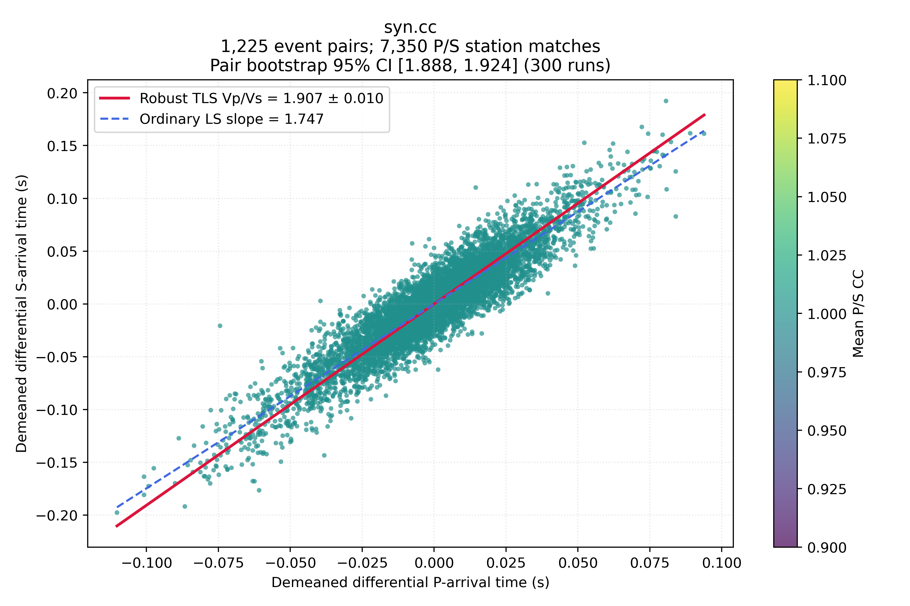

A Python code to calculate in-situ Vp/Vs ratio using pairs of P and S cross-correlation or catalog differential travel times from a tight cluster of events. You can obtain the differential times using FDTCC (cross-correlation-based differential times, recommended) or ph2dt (catalog-based differential times) programs. I use a robust L1-L2 fitting algorithm from Lin and Shearer (2007) to calculate the ratio.

The FDTCC program can be found here:  https://github.com/MinLiu19/FDTCC  
The ph2dt program can be found here: https://github.com/fwaldhauser/HypoDD

**Input Format**  
InsVpVs works based on dt.cc file derived from FDTCC (recommended) and dt.ct file derived from hypoDD:  
```
dt.cc format:
# event_ID1     event_ID2    0
station     differential_time       CC    phase

dt.ct format:
# event_ID1     event_ID2
station   tt_1    tt_2    1.00    phase
```

If the ph2dt program output file is used, differential times are calculated as ```tt_1 - tt_2```.
<div id="header" align="center">
  
</div>

